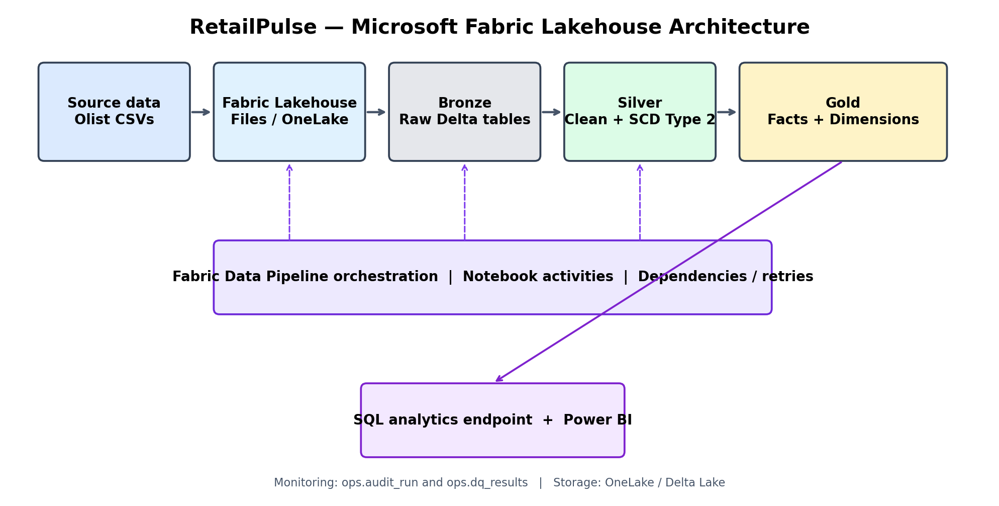

# RetailPulse — End-to-End Retail Data Engineering on Microsoft Fabric

[]()
[]()
[]()
[](LICENSE)

RetailPulse is a portfolio-grade retail analytics lakehouse built entirely on **Microsoft Fabric**. It demonstrates how to ingest public retail data, preserve raw source files, transform data through Bronze/Silver/Gold layers, maintain customer history with SCD Type 2, apply data-quality rules, and publish analytics-ready star-schema tables.

> **Important:** This repository contains the project code, notebook templates, SQL, test examples, and deployment guidance. You must create the Fabric workspace, Lakehouse, pipeline activities, connections, and Power BI report in your own tenant. No Fabric workspace or tenant is provisioned by this repository.

## Business problem

A fictional omnichannel retailer receives order, customer, product, seller, payment, review, and shipping data. Analysts need trusted metrics such as revenue, order volume, delivery performance, product performance, and customer trends. The platform must also retain historical customer attributes when a customer changes their city or state.

## Architecture



**Flow:** Public CSV source files → Fabric Lakehouse Files → Bronze Delta tables → Silver cleaned/conformed tables → Gold dimensions and facts → SQL analytics endpoint / Power BI.

## Technology

- Microsoft Fabric Workspace
- Fabric Lakehouse / OneLake
- Fabric Notebooks (PySpark)
- Delta Lake tables
- Fabric Data Pipelines for orchestration
- Lakehouse SQL analytics endpoint for SQL consumption
- Power BI for reporting

No Databricks, Snowflake, Azure Data Factory, or external compute is required.

## Dataset

This project is designed for the public **Brazilian E-Commerce Public Dataset by Olist** (Kaggle). It includes orders, customers, order items, payments, products, sellers, reviews, and geolocation.

1. Download the dataset from Kaggle: https://www.kaggle.com/datasets/olistbr/brazilian-ecommerce
2. Extract the CSV files.
3. Upload the CSVs to the Lakehouse `Files/source/olist/` folder.
4. Use the expected filenames documented in `docs/data_dictionary.md`.

The dataset is historical and public. It is not live retail data. Do not upload confidential employer or customer data.

## Repository layout

```text
RetailPulse-Data-Engineering/
├── README.md
├── LICENSE
├── .gitignore
├── architecture/
│   └── retailpulse_architecture.png
├── config/
│   └── project_config.json
├── notebooks/
│   ├── 00_setup_and_config.ipynb
│   ├── 01_bronze_ingestion.ipynb
│   ├── 02_silver_transformations.ipynb
│   ├── 03_customer_scd_type2.ipynb
│   ├── 04_gold_model.ipynb
│   └── 05_data_quality_and_audit.ipynb
├── sql/
│   ├── gold_business_queries.sql
│   └── validation_queries.sql
├── pipelines/
│   └── pipeline_build_guide.md
├── docs/
│   ├── architecture_and_design.md
│   ├── data_dictionary.md
│   ├── deployment_guide.md
│   └── limitations_and_next_steps.md
└── tests/
    └── test_design_checks.py
```

## Quick start

### 1. Create Fabric resources
- Create a Fabric workspace with an available Fabric capacity/trial.
- Create a Lakehouse named `lh_retailpulse`.
- Create the folders `Files/source/olist/` and `Files/rejects/`.
- Upload the Olist CSV files to `Files/source/olist/`.
- Create/import the notebooks from `notebooks/` and attach each to `lh_retailpulse`.

### 2. Run notebooks in order
1. `00_setup_and_config`
2. `01_bronze_ingestion`
3. `02_silver_transformations`
4. `03_customer_scd_type2`
5. `04_gold_model`
6. `05_data_quality_and_audit`

Run the notebooks in the Fabric Spark environment. The notebooks use the default Lakehouse attachment and relative OneLake paths.

### 3. Build orchestration
Follow `pipelines/pipeline_build_guide.md` to create a Fabric Data Pipeline with notebook activities in the same order. Configure dependencies so downstream notebooks only run after upstream success.

### 4. Query Gold tables
Open the Lakehouse SQL analytics endpoint and run the queries in `sql/gold_business_queries.sql`. Create a Power BI report from the Gold tables.

## Data model

**Dimensions**
- `dim_customer` — customer surrogate key, natural customer ID, current customer attributes.
- `dim_product` — product attributes.
- `dim_seller` — seller attributes.
- `dim_date` — calendar dimension.

**Facts**
- `fact_order_item` — one row per order item, with order/customer/product/seller keys and item-level measures.
- `fact_order_payment` — one row per payment record.

**Operational tables**
- `audit_run` — notebook execution/run metadata.
- `dq_results` — data-quality check results.

## Engineering features demonstrated

- Explicit schema definitions for source data.
- Raw Bronze ingestion with source filename and ingestion timestamp.
- Idempotent overwrite of Bronze source snapshots.
- Silver type casting, trimming, deduplication, and null handling.
- Customer SCD Type 2 using a Delta `MERGE`-style expire/insert pattern.
- Star schema and surrogate keys.
- Data-quality checks and audit logging.
- SQL validation and business KPI queries.
- Fabric-native orchestration and Power BI consumption.

## Known design choices

- The public Olist dataset is a historical snapshot, not a CDC feed. SCD Type 2 is demonstrated using a repeatable customer-change simulation in notebook 03. In a production CDC system, use source change events or reliable effective timestamps.
- The sample notebooks use a full Bronze refresh for simplicity and reproducibility. Incremental ingestion, watermarking, and file-arrival tracking are documented as production extensions.
- The repository does not claim production deployment, measured scale, or performance benchmarks. Add those only after you have run and measured them in your Fabric workspace.

## Suggested LinkedIn description

> Built RetailPulse, an end-to-end retail lakehouse on Microsoft Fabric using PySpark, Delta Lake, and Fabric Data Pipelines. The project demonstrates Bronze/Silver/Gold processing, customer SCD Type 2, data-quality checks, dimensional modelling, and business KPI queries using a public e-commerce dataset.
>
> GitHub: [add your repository URL]

## License
MIT. Dataset ownership and terms remain with the original dataset publisher; refer to the Kaggle dataset page for its terms.
